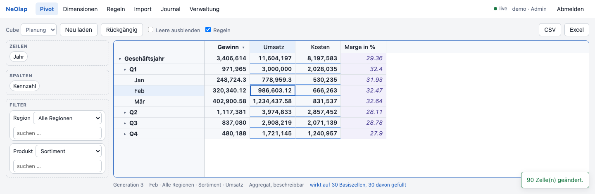
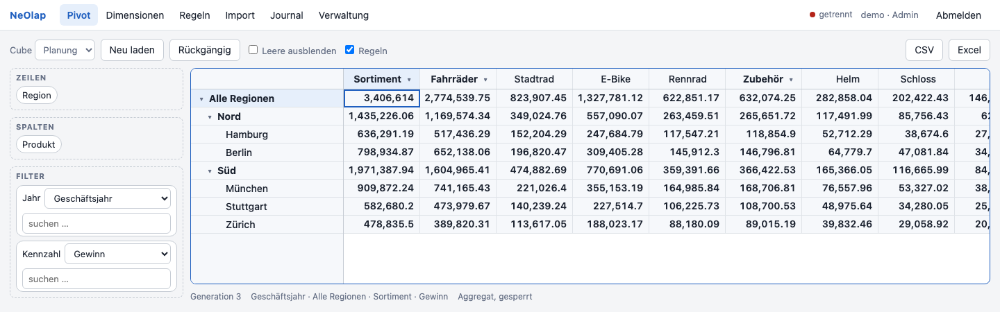
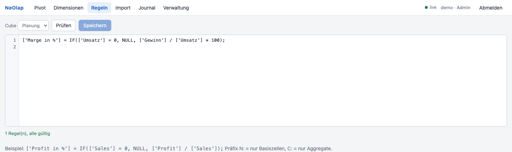
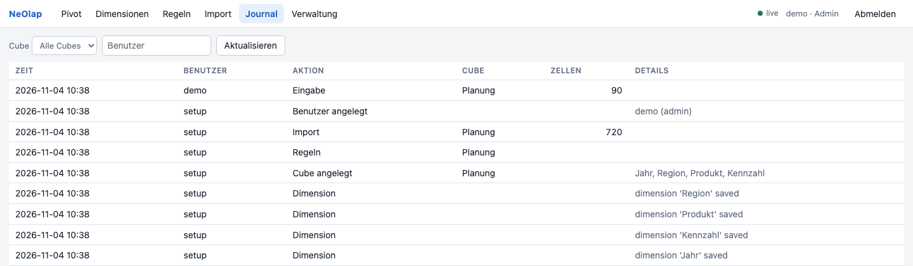
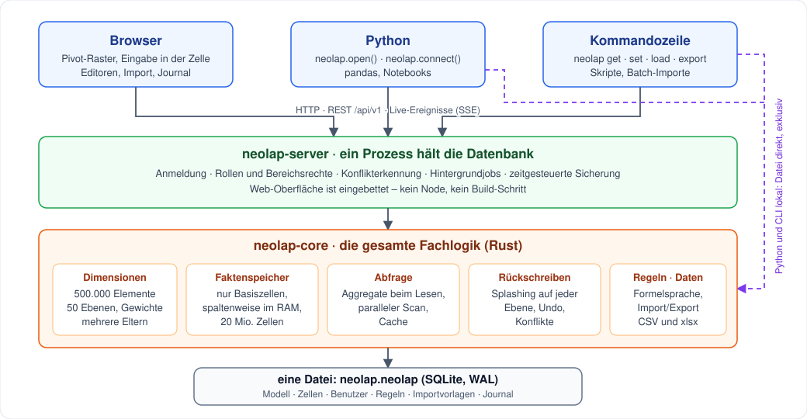
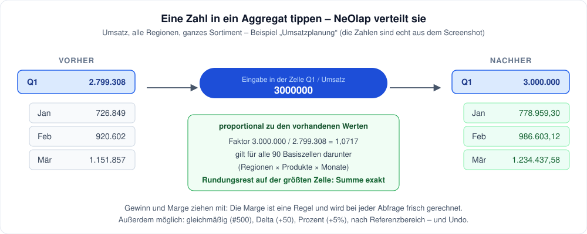
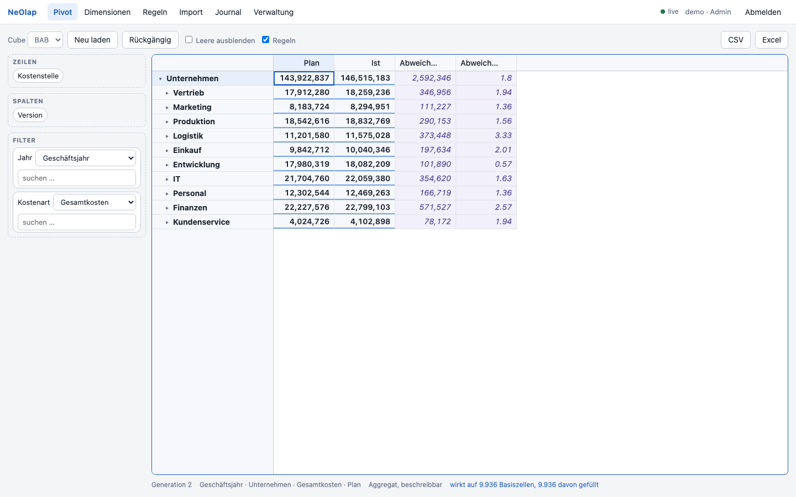
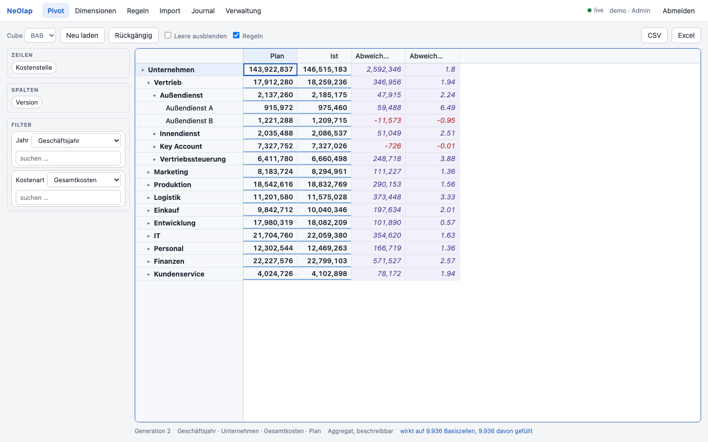
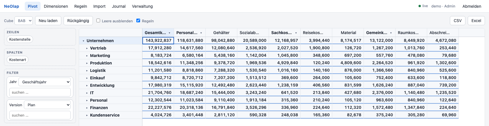
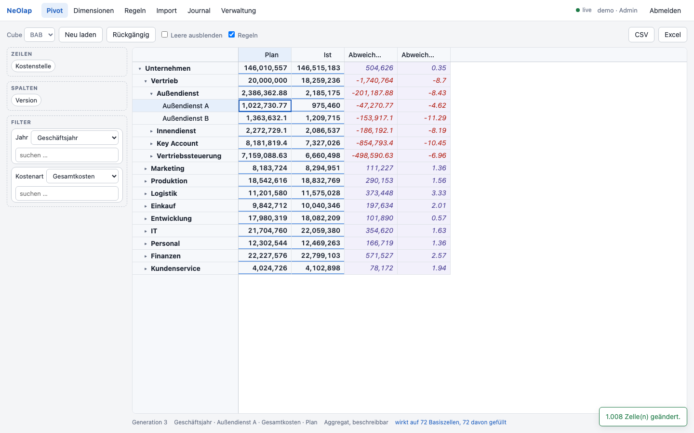

# NeOlap

**Planen, rechnen und zusammenarbeiten in mehrdimensionalen Zahlen – in einer Datei, mit einem Befehl gestartet.**

NeOlap ist eine leichtgewichtige multidimensionale Datenbank (MOLAP) im Geist von MIS Alea und TM1. Tippen Sie eine Zahl in eine **Summenzelle**, und NeOlap verteilt sie auf die Zellen darunter. Eine Formel rechnet, wo sie gilt. Mehrere Personen arbeiten gleichzeitig im Browser, und jede Änderung steht im Journal. Geschrieben in Rust, ausgeliefert als ein Programm.



<sub>Das Beispiel „Umsatzplanung“ aus [`examples/`](examples/build_planning_demo.py): Im ersten Quartal wurden 3.000.000 Umsatz eingegeben. Die 90 Zellen darunter (Städte × Produkte × Monate) wurden proportional angepasst, der Gewinn zieht mit, und die Marge ist eine Regel.</sub>

> **Status:** Die Meilensteine M0–M10 sind umgesetzt, M11 (Härtung und Betrieb) ist bis auf die Referenzhardware für die Zielwerte fertig. Version 1.1.0 ist als GitHub-Release veröffentlicht (Programme, Python-Wheels, Container-Image). Es gibt kein Python-Paket auf PyPI. Die Web-Oberfläche ist im Headless-Browser geprüft, aber noch nicht von einer Person abgenommen ([Checkliste](docs/Abnahme-M9.md)). Siehe [Einschränkungen](#einschränkungen).

## Warum NeOlap?

| | |
|---|---|
| **Summen sind beschreibbar** | Eingabe auf jeder Ebene einer Hierarchie: proportional, gleichmäßig, als Delta (`+50`), als Prozent (`+5%`) oder nach dem Muster eines anderen Bereichs. Rückgängig mit Strg+Z. |
| **Tiefe, echte Hierarchien** | Bis zu 500.000 Elemente je Dimension, 50 Ebenen, ungleichmäßige Bäume, Gewichte (Kosten zählen negativ), Elemente mit mehreren Eltern. |
| **Formeln wie in einer Tabellenkalkulation** | `['Marge in %'] = IF(['Umsatz'] = 0, NULL, ['Gewinn'] / ['Umsatz'] * 100);` – eine Zeile, gilt für das ganze Modell. Ebenso die Plan-Ist-Abweichung im BAB-Beispiel. |
| **Zusammenarbeit ohne Chaos** | Anmeldung, Rollen, Schreibrechte bis auf Bereiche, Konflikterkennung („jemand hat diese Zelle inzwischen geändert“), Live-Aktualisierung, Änderungsjournal. |
| **Ein Programm, eine Datei** | Das Programm enthält Server, Web-Oberfläche und Kommandozeile. Alle Daten liegen in einer SQLite-Datei. Kein Node, keine Datenbankinstallation. |
| **Python inklusive** | Dieselbe API auf einer Datei oder gegen einen Server, mit pandas und Notebooks. |

## So sieht es aus

**Zwei Hierarchien gleichzeitig.** Städte in Regionen auf den Zeilen, Produkte in Gruppen auf den Spalten. Ziehen Sie eine Dimension auf Zeilen, Spalten oder Filter, und klappen Sie Ebenen auf, so weit Sie wollen.



**Regeln im Editor.** Prüfen vor dem Speichern, mit der Meldung, welche Regel wo scheitert.



**Jede Änderung ist nachvollziehbar.** Wer hat wann was getan, wie viele Zellen waren betroffen.



## Wie es funktioniert



Die gesamte Fachlogik steckt in `neolap-core`. Server, Kommandozeile und Python-Modul sind dünne Hüllen darum, deshalb verhält sich NeOlap überall gleich.

**Nur Basiszellen werden gespeichert.** Summen entstehen beim Lesen: ein paralleler Scan über spaltenweise abgelegte Zellen, danach ein Cache. Das spart den Index, der beim Original für jede Summe jeder Zelle nötig wäre, und lässt 20 Mio. Zellen in etwa 2,1 GB passen. Ein Wert, den niemand ändert, kommt beim zweiten Lesen in Mikrosekunden aus dem Cache.

**Rückschreiben ist eine Transaktion.** Eine Eingabe in eine Summe wird auf die Basiszellen verteilt (Rundungsrest auf der größten Zelle, damit die Summe exakt stimmt), gegen die Rechte jeder betroffenen Zelle geprüft, im Journal festgehalten und kann mit einem Schritt zurückgenommen werden.



## Wie schnell ist es?

Gemessen an einem **synthetischen Großmodell**: 20 Dimensionen, darunter zwei mit 500.000 Elementen und 50 Ebenen, Elemente mit mehreren Eltern, negative Gewichte, 20 Mio. Zellen. Gemessen wurde der *ungünstigste* Fall für Summen, nämlich große Elementmengen auf mehreren Dimensionen zugleich.

| | Ziel | Apple M4 Pro (14 Kerne) | Linux-Runner (2 Kerne), 4-GB-Container |
|---|---|---|---|
| Summe, ungünstigster Fall, 10 Mio. Zellen | < 100 ms | **63–71 ms** | nicht gemessen |
| Summe, ungünstigster Fall, 20 Mio. Zellen | | 103–117 ms | 0,6–1,5 s |
| Summe, zufällige Teilbäume, 20 Mio. Zellen | < 100 ms | 3 ms | 64 ms |
| Wert im Cache | < 5 ms | < 1 µs | 2 µs |
| Pivot 50 × 20, 10 Mio. Zellen | < 500 ms | **53 ms** | nicht gemessen |
| Splash über 100.000 Zellen | < 2 s | **9 ms** | nicht gemessen |
| Import von 1 Mio. CSV-Zeilen | < 10 s | **1,7 s** | nicht gemessen |
| Start mit 10 Mio. Zellen | < 20 s | **2,6 s** | nicht gemessen |
| Dimension mit 495.000 Elementen importieren | < 5 s | **0,29 s** | nicht gemessen |
| Speicher bei 20 Mio. Zellen | ≈ 2,4 GB | 2,1 GB | 2,6 GB Spitze (Limit 4 GB) |

**Ehrlich dazu:** Die Zielwerte stehen ohne Angabe der Rechnergröße im Plan. Auf 14 Kernen sind alle erreicht. Auf dem 2-Kern-Runner braucht der ungünstigste Fall bei 20 Mio. Zellen über eine Sekunde, weil der Scan mit der Kernzahl skaliert. Für das Maximum von 20 Mio. Zellen sind mindestens 4 Kerne sinnvoll. Details und Messweg: [Handbuch, Kapitel 8](docs/Handbuch.md#8-leistung).

## Schnellstart

### 1. Ausprobieren in zwei Minuten

Sie brauchen Rust ≥ 1.89 ([rustup.rs](https://rustup.rs)) und Python 3.

```sh
git clone https://github.com/langdar2/NeOlap && cd NeOlap
cargo build --release -p neolap-cli
export NEOLAP=$PWD/target/release/neolap

python3 examples/build_planning_demo.py planung.neolap     # baut das Beispiel „Umsatzplanung“
$NEOLAP serve --data-dir . --database planung.neolap       # → http://127.0.0.1:8080
```

Anmelden mit Benutzer `demo`, Passwort `demo-passwort-123`. Klappen Sie im Pivot das Geschäftsjahr und Q1 auf, wählen Sie die Zelle *Q1 / Umsatz*, tippen Sie `3000000` und drücken Sie Enter.

> Das Beispielpasswort ist öffentlich bekannt. Nutzen Sie das Beispiel nur lokal.

### Zweites Beispiel: BAB-Planung mit Plan und Ist

Ein Betriebsabrechnungsbogen, wie ihn ein Controlling pflegt: **10 Bereiche, 35 Abteilungen, 138 Teams** (je Bereich 2–5 Abteilungen, je Abteilung 2–5 Teams), dazu 6 Kostenarten und 12 Monate. Es sind rund 20.000 Zellen mit erfundenen Zahlen.

| Dimension | Aufbau |
|---|---|
| Kostenstelle | Unternehmen → Bereich → Abteilung → Team (4 Ebenen, 184 Elemente) |
| Kostenart | Gesamtkosten → Personal-, Sach-, Gemeinkosten → 6 Kostenarten (Gehälter, Sozialabgaben, Reisekosten, Material, Raumkosten, Abschreibungen) |
| Jahr | Geschäftsjahr → Quartale → Monate |
| Version | **Plan**, **Ist**, **Abweichung**, **Abweichung in %** |

Plan und Ist stehen nebeneinander in einer Dimension, nicht in zwei Cubes. Die beiden Abweichungen werden nicht gespeichert, sondern von zwei Regeln berechnet, auf jeder Ebene der Kostenstellen-Hierarchie:

```
['Abweichung'] = ['Ist'] - ['Plan'];
['Abweichung in %'] = IF(['Plan'] = 0, NULL, ['Abweichung'] / ['Plan'] * 100);
```

```sh
python3 examples/build_bab_demo.py bab.neolap
$NEOLAP serve --data-dir . --database bab.neolap
```



<sub>Die zehn Bereiche mit Plan, Ist und den beiden berechneten Spalten. Negative Abweichungen sind rot.</sub>



<sub>Vertrieb → Außendienst → Team. Die Abweichung wird auf jeder Ebene berechnet, auch bei den Teams.</sub>



<sub>Die Kostenarten in den Spalten: Gesamtkosten, die Gruppen Personal-, Sach- und Gemeinkosten und darunter die sechs Kostenarten. Version *Plan*, Geschäftsjahr. Die Gruppen lassen sich auf- und zuklappen wie die Kostenstellen.</sub>

Anmeldung wie oben. Probieren Sie im Browser: Kostenstelle auf *Vertrieb* einklappen, Geschäftsjahr auf *Q1*, Kostenart *Gesamtkosten*, Version *Plan*, dort `5000000` eingeben. Die Summe verteilt sich auf alle Teams, Kostenarten und Monate darunter (252 Basiszellen). Die Abweichung ändert sich mit.



<sub>Im Bild wurden 20.000.000 auf *Vertrieb / Plan* eingegeben (Geschäftsjahr, Gesamtkosten). Betroffen sind 1.008 Basiszellen. Der Plan liegt nun über dem Ist, die Abweichung des Bereichs fällt auf −8,7 %.</sub>

Dasselbe auf der Kommandozeile (Reihenfolge der Elemente wie in den Cube-Dimensionen: Jahr, Kostenstelle, Kostenart, Version):

```sh
neolap get bab.neolap BAB --rules Q1 Vertrieb Gesamtkosten "Abweichung in %"
neolap set bab.neolap BAB Q1 Vertrieb Gesamtkosten Plan +5%        # Plan im Vertrieb um 5 % erhöhen
neolap export bab.neolap BAB --area "Version=Ist|Plan,Kostenart=Gehälter" -o gehaelter.csv
```

> Das Beispiel enthält keine Umlage von Hilfs- auf Hauptkostenstellen. Die Bilder stammen aus dem Headless-Browser, nicht aus einer Abnahme von Hand.

### 2. Fertiges Programm

Für macOS (universal), Linux (x86_64, arm64) und Windows baut der Workflow `release.yml` Archive mit Prüfsumme. Sie hängen am [GitHub-Release](https://github.com/langdar2/NeOlap/releases) (aktuell `v1.1.0`). Hinweise zu Gatekeeper und SmartScreen: [Handbuch, Kapitel 3.2](docs/Handbuch.md#32-fertiges-programm-aus-dem-release).

### 3. Server mit Docker Compose

Voraussetzung: Docker mit Compose v2.

```sh
cp .env.example .env              # NEOLAP_ADMIN_PASSWORD setzen (mind. 10 Zeichen)
docker compose up -d --build
```

Beim ersten Start legt der Server mit `NEOLAP_ADMIN_USER` und `NEOLAP_ADMIN_PASSWORD` den Administrator an; danach die Zeilen aus der `.env` entfernen. Die Daten liegen im Volume `neolap-data`, das Speicherlimit steht standardmäßig auf 4 GB, und der Port ist nur vom eigenen Rechner erreichbar (`127.0.0.1`). Für Zugriff im Team mit HTTPS: `NEOLAP_DOMAIN=<servername>`, `NEOLAP_SECURE_COOKIES=true`, `NEOLAP_TRUST_PROXY=true` setzen und `docker compose --profile tls up -d` starten (Caddy kümmert sich um das Zertifikat). Der Server sichert täglich in `/data/backup` und behält die letzten sieben.

Betrieb, Sicherung, Wiederherstellung und Aktualisierung: [Handbuch](docs/Handbuch.md).

## Aus Python

Das Release `v1.1.0` enthält Wheels für macOS (arm64, x86_64), Linux (x86_64, aarch64) und Windows (amd64), jeweils für Python ab 3.9. Der Workflow `wheels.yml` installiert jedes Wheel in einer sauberen Umgebung und importiert es; auf einem Rechner ausprobiert wurde bisher nur macOS arm64. Das Paket liegt **nicht auf PyPI**. Wheel aus dem Release laden und installieren (`pip install <Datei>.whl`) oder aus dem Quelltext bauen:

```sh
python3 -m venv .venv && source .venv/bin/activate
pip install maturin pandas
cargo build -p neolap-cli
maturin develop --release -m crates/neolap-py/Cargo.toml
```

```python
import neolap

db = neolap.open("planung.neolap")                                  # eine Datei, exklusiv
# db = neolap.connect("https://olap.intern:8443", token="nlp_…")    # oder ein Server – dieselbe API

cube = db.cube("Planung")
cube["Q1", "Alle Regionen", "Sortiment", "Umsatz"] = 3_000_000      # Summe: wird verteilt
cube.write(("Q2", "Nord", "Sortiment", "Umsatz"), "+5%")            # 5 % mehr, auf alle Zellen darunter
cube.undo()                                                          # und zurück

df = cube.area(Jahr=["Jan", "Feb", "Mär"], Region="Berlin").to_pandas()  # Bereich als DataFrame
df["value"] *= 1.05                                                      # mit pandas rechnen …
cube.load(df, mapping={d: d for d in cube.dimensions}, value_column="value")   # … und zurückschreiben
```

Die Beispiele laufen unverändert auf einer Datei und gegen einen Server, ebenso das Notebook [`tiny.ipynb`](crates/neolap-py/examples/tiny.ipynb). Eine Datei ist exklusiv: Ein laufender Server und ein Python-Prozess können nicht dieselbe Datei öffnen (`neolap.LockedError`).

## Kommandozeile

```sh
neolap info planung.neolap                                # Dimensionen, Cubes, Regeln, Benutzer
neolap get planung.neolap Planung Q1 Nord Sortiment Umsatz
neolap set planung.neolap Planung Q1 Nord Sortiment Umsatz +5%
neolap load planung.neolap vorlage.toml --dry-run         # Import prüfen, ohne zu ändern
neolap export planung.neolap Planung -o planung.xlsx     # Bereich als CSV oder Excel
neolap model export planung.neolap modell/                # Modell als lesbare Dateien (Git-tauglich)
neolap journal planung.neolap                             # was wurde wann von wem geändert
```

`neolap --help` zeigt alle Befehle.

## Einschränkungen

Was NeOlap in dieser Fassung nicht kann oder nicht belegt hat:

- **Kein Python-Paket auf PyPI.** Die Wheels hängen nur am GitHub-Release.
- **Container-Image.** `ghcr.io/langdar2/neolap` wird bei Release-Tags veröffentlicht. Der Abruf ohne Anmeldung ist für `1.1.0` und `latest` geprüft (Manifest, amd64 und arm64); gestartet wurde das Image dabei nicht.
- **Leistung auf kleinen Servern.** Auf 2 Kernen ist der ungünstigste Fall bei 20 Mio. Zellen langsam (siehe Tabelle).
- **Kein eingebautes HTTPS.** Dafür gibt es das Caddy-Profil oder einen eigenen Proxy.
- **Anmeldungen und laufende Importe liegen im Speicher.** Nach einem Neustart müssen sich alle neu anmelden.
- **Keine Zahlenformate im Modell, kein Grund für gesperrte Zellen, kein polars.**
- **Plattformen:** Linux/amd64 ist in der CI geprüft. Die Windows-, macOS-Intel- und arm64-Container-Läufe sind nie ausgeführt worden. Die Web-Oberfläche hat noch keine menschliche Abnahme.
- **Lesen wird je Cube vergeben, Schreiben je Zelle.** Leserechte auf Elementebene sind für Phase 2 vorgesehen.

Die vollständige Liste mit Begründungen steht im [Handbuch](docs/Handbuch.md#10-bekannte-einschränkungen-v1) und in [docs/entscheidungen.md](docs/entscheidungen.md).

## Entwickeln

```sh
cargo test                       # Engine, Server, Kommandozeile
node --test ui/tests/*.test.js   # Web-Oberfläche (Node ≥ 22, ohne Abhängigkeiten)
pytest crates/neolap-py/tests    # Python, jeder Test läuft lokal und gegen einen Server (nach maturin develop)

# Großmodell-Messung (20 Dimensionen, 20 Mio. Zellen; braucht etwa 3 GB Speicher)
cargo test --release -p neolap-core --lib -- --ignored --nocapture synth_targets
```

| Pfad | Inhalt |
|---|---|
| `crates/neolap-core` | Engine: Modell, Speicher, Abfrage, Splashing, Regeln, Persistenz, Import/Export, Rechte |
| `crates/neolap-server` | REST-API `/api/v1`, Anmeldung, Ereignisse, Sicherung, eingebettete Web-Oberfläche |
| `crates/neolap-cli` | Programm `neolap` |
| `crates/neolap-py` | Python-Modul (PyO3, maturin) |
| `ui/` | Web-Oberfläche (HTML, CSS und JavaScript-Module, ohne Build-Schritt) |
| `examples/` | Beispielmodelle „Umsatzplanung“ und „BAB-Planung“ |
| `Dockerfile`, `docker-compose.yml`, `deploy/` | Container-Betrieb, optionaler HTTPS-Proxy (Caddy) |
| `docs/` | [Implementierungsplan](docs/Implementierungsplan.md), [Entscheidungen](docs/entscheidungen.md), [Handbuch](docs/Handbuch.md) |

## Herkunft und Lizenz

NeOlap ist eine Neuimplementierung auf Basis der Konzepte von [TinyOlap](https://github.com/Zeutschler/tinyolap) von Thomas Zeutschler (Python, MIT). Die Gründe für den Neubau (Leistungsziele, Mehrbenutzerbetrieb) stehen in den [Entscheidungen](docs/entscheidungen.md) E1 bis E3. MIT-Lizenz, siehe [LICENSE](LICENSE) und [NOTICE.md](NOTICE.md).
